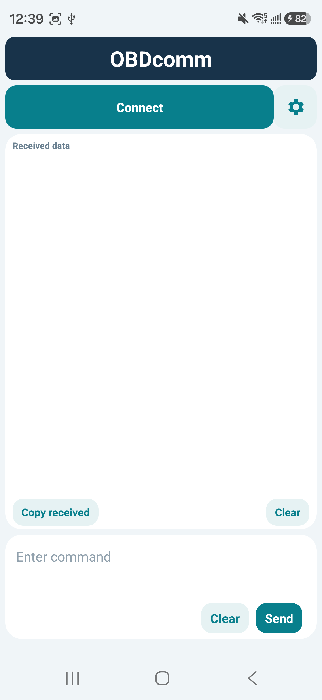
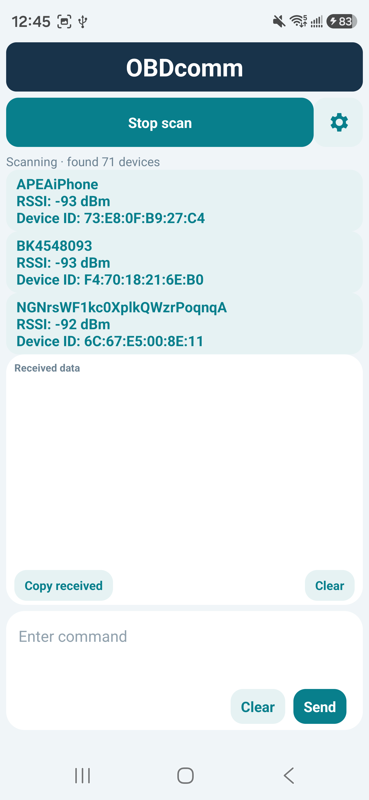
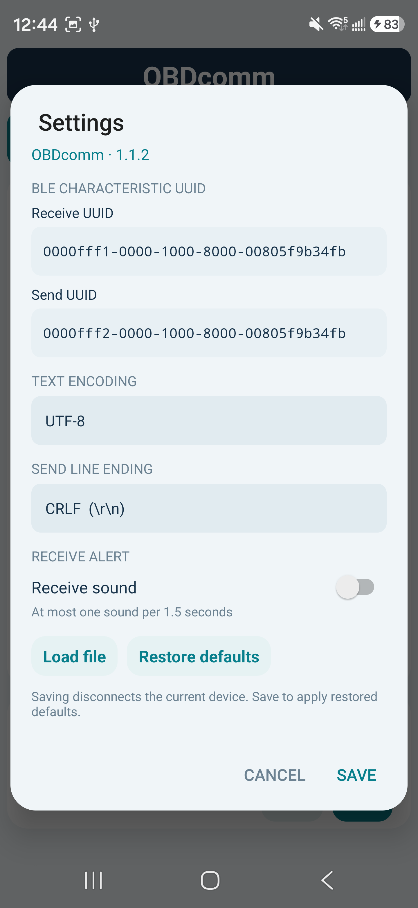

# OBDcomm

**English** | [简体中文](README.zh-CN.md)

OBDcomm is a lightweight Bluetooth Low Energy (BLE) terminal for Android. It works with OBDplus and other peripherals that expose GATT characteristics for sending and receiving data. Version **1.1.2** supports Android 6.0 and later.

## Screenshots

These screenshots were taken on an Android phone. The app uses Chinese on Chinese-language systems and English otherwise.

| Terminal | Device scan | Settings |
| --- | --- | --- |
|  |  |  |

## Features

- Discover nearby BLE devices and display their names, signal strength (RSSI in dBm), and Bluetooth addresses. Named devices appear first, and known names are retained across scans.
- Scan, connect, cancel a connection attempt, or disconnect using one button. Once connected, the device list collapses and the button displays the device name.
- Copy or clear received data and send text from a separate input field.
- Choose UTF-8 or GBK and append CRLF, CR, or LF to outgoing text.
- Customize the receive and send characteristic UUIDs or restore the defaults.
- Enable an optional receive sound, limited to once every 1.5 seconds during continuous reception.
- Load a file through Android's file picker and send its original bytes after confirming.

## Usage

### Install and connect

1. Build the APK in Android Studio or install `OBDcomm-debug.apk` from a trusted source. Use a release signing key for production distribution.
2. Enable Bluetooth and system location. Grant Nearby devices and precise location permissions when prompted. Android uses location permission for full BLE scanning. OBDcomm does not upload scan data.
3. Tap **Connect** to scan for up to 60 seconds. Tap the same button to stop scanning early.
4. Select your peripheral. The app shows the connected state after it finds the configured characteristics and subscribes to receive notifications or indications.
5. The connection button turns green and shows the device name. Tap it to disconnect. Disconnections and connection failures are shown in red.

A peripheral must advertise to appear in the scan. Devices can use randomized addresses that change over time. A device without a known broadcast name is shown as **No advertised name**.

### Receive and send data

- Incoming bytes are decoded using the selected encoding. Multi-byte characters can span BLE packets.
- Tap **Copy received** to copy the displayed data or **Clear** in the receive panel to empty it.
- Enter a command and tap **Send** on the right. The app appends the configured line ending.
- Tap **Clear** beside **Send** to empty the input or unload a file and return to text entry.
- The receive buffer holds 8 KiB, and the display retains roughly the most recent 128K characters. This accommodates 1–2 KiB messages and data split across packets.

### Settings and defaults

Tap the gear icon to open **Settings**. Saving settings disconnects the current peripheral. Reconnect to continue.

| Setting | Default |
| --- | --- |
| Receive characteristic UUID | `0000FFF1-0000-1000-8000-00805F9B34FB` |
| Send characteristic UUID | `0000FFF2-0000-1000-8000-00805F9B34FB` |
| Encoding | UTF-8 |
| Send line ending | CRLF (`\r\n`) |
| Receive sound | Off |

Tap **Restore defaults**, then **Save** to apply the values above. **Cancel** discards edits. Receive sounds use the phone's notification volume and may be affected by silent mode or Do Not Disturb.

### Send a file

1. Open **Settings**, tap **Load file**, and choose a file up to 8 MiB.
2. The main input field displays the filename and size in bytes.
3. Tap **Send** and confirm. The app writes the original bytes in 20-byte chunks without encoding conversion or an appended line ending.
4. The progress counter tracks BLE writes. Device-side validation and flashing depend on the peripheral. Disconnect to stop the remaining transfer.

Firmware updates require support from the target device. Implement any device-specific handshake, addressing, checksums, acknowledgments, and retries separately.

## Screen and background behavior

The app keeps the screen on during a connection. The Android activity owns the connection, so reception may stop when the phone locks, the activity closes, or Android kills the process. Reliable reception with the screen off requires a `connectedDevice` foreground service and testing with delayed data on the target phone.

## Build locally

Use JDK 21, Android SDK 35, Android Gradle Plugin 8.7.3, and Gradle 8.12. The app uses Java and native Android views.

1. Open the project root in Android Studio.
2. Install Android SDK Platform 35 using SDK Manager and select a compatible Gradle JDK.
3. Set `sdk.dir` in your local `local.properties` and keep that file out of Git.
4. Build the debug APK and run lint.

```powershell
.\gradlew.bat assembleDebug lintDebug
```

On macOS or Linux, run `sh gradlew assembleDebug lintDebug`.

The APK is generated at `app/build/outputs/apk/debug/app-debug.apk`. The first build requires internet access to download Gradle and Android build dependencies.

## Project layout

```text
app/src/main/java/com/obdcomm/MainActivity.java  UI, BLE, and data transfer
app/src/main/AndroidManifest.xml               Permissions and app entry point
app/src/main/res/                              Icons and other Android resources
OBDcomm.png                                   Original icon artwork
```

## Verification

The debug build and Android lint passed. The app was installed and launched on a Samsung phone, where scanning discovered OBDplus, L3250 Series, and a Xiaomi humidifier. Communication reliability, firmware update protocols, and extended background reception require testing with the target hardware.
