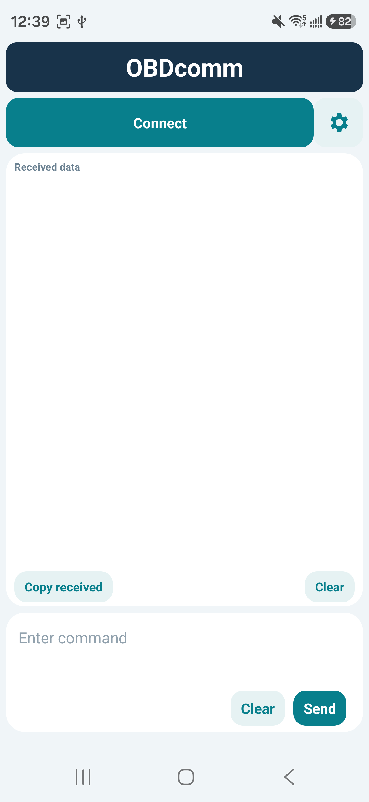
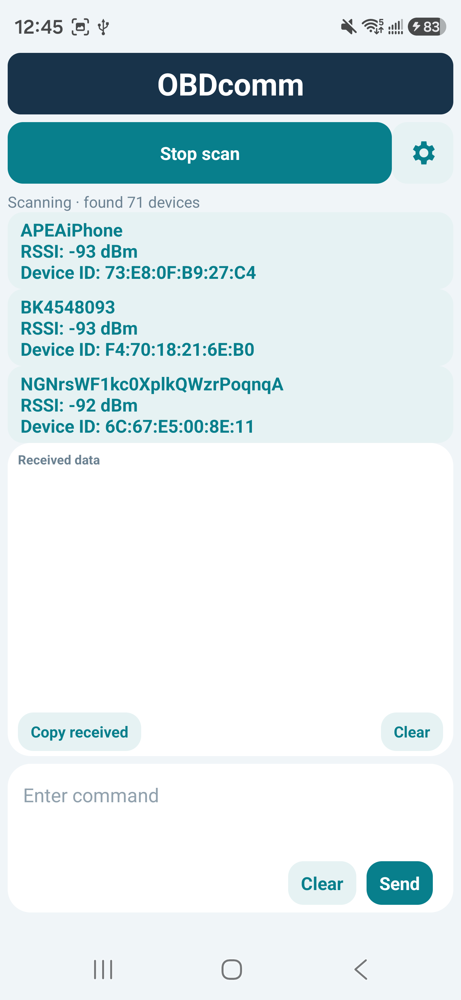
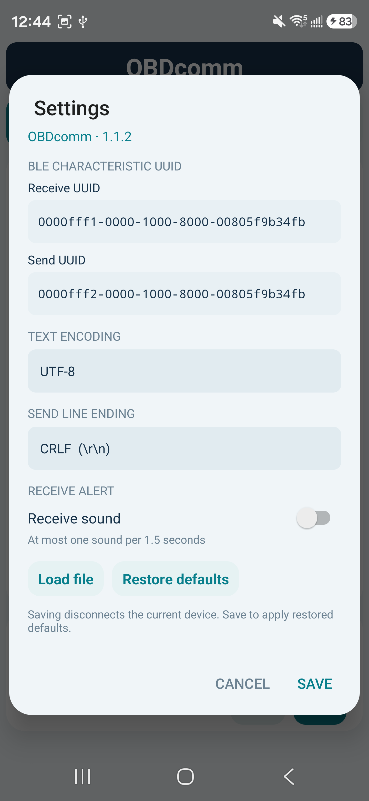

# OBDcomm

[English](README.md) | **简体中文**

轻量 Android BLE 通信终端，适用于 OBDplus 等使用 GATT 特征收发数据的设备。当前版本 **1.1.2**，支持 Android 6.0 及以上。

## 界面截图

截图来自真实 Android 手机，界面语言随系统语言变化。

| 主界面 | 扫描设备 | 设置 |
| --- | --- | --- |
|  |  |  |

## 功能

- 扫描附近 BLE 广播，显示设备名称、RSSI（dBm）和设备 ID（蓝牙地址）。有名称的设备优先显示，保留已识别名称。
- 单按钮完成扫描、连接、取消连接及断开；连接后收起扫描列表，按钮下方显示设备名。
- 大接收窗口，支持复制和清空；小发送窗口，支持发送文本和清空输入。
- UTF-8 / GBK 编码，可配置 CRLF、CR、LF 发送换行。
- 可自定义收发 UUID，并恢复默认配置。
- 可选接收提示音，连续分包最多每 1.5 秒提示一次。
- 从系统文件选择器载入文件，显示文件名和大小，确认后原样分包发送。
- 中文系统显示中文，其他系统语言显示英文。

## 使用方法

### 安装与连接

1. 在 Android Studio 构建 APK，或安装可信来源提供的 `OBDcomm-debug.apk`。调试包适合测试；正式分发应使用自己的发布签名。
2. 开启手机蓝牙及系统位置开关，允许应用的附近设备和精确位置权限。位置权限用于完整 BLE 扫描，应用不上传扫描数据。
3. 点击 **连接 / Connect**，扫描最多持续 60 秒，再次点击可停止扫描。
4. 在设备列表中点击目标设备。应用发现配置的收发特征并成功订阅通知后，才显示已连接。
5. 连接按钮变绿并显示设备名；点击可断开。连接失败或断开以红色提示。

设备必须正在发送 BLE 广播才能被发现；设备 ID 可能采用会变化的随机地址。没有携带名称的广播显示“未广播名称”，应用不会根据地址猜测型号。

### 接收与发送

- 接收数据按当前编码解码，跨 BLE 分包保留多字节字符状态。
- 点击 **复制接收数据** 复制当前窗口内容；接收区的 **清除** 清空显示。
- 在下方输入指令，点击最右侧 **发送**。文本自动追加当前配置的换行字符。
- 发送区 **清除** 清空输入；如已载入文件，则取消文件载入并恢复文本输入。
- 接收字节缓冲为 8 KiB，显示保留最近约 128K 字符，适合 1–2 KiB 及分包数据。它不是无限日志存储器。

### 设置与默认值

点击右侧齿轮打开设置。保存配置会断开当前连接，需要重新连接。

| 配置 | 默认值 |
| --- | --- |
| 接收特征 UUID | `0000FFF1-0000-1000-8000-00805F9B34FB` |
| 发送特征 UUID | `0000FFF2-0000-1000-8000-00805F9B34FB` |
| 编码 | UTF-8 |
| 发送换行 | CRLF（`\r\n`） |
| 接收提示音 | 关闭 |

点击 **恢复默认值** 会填入上述配置，点击 **保存** 后生效；点击取消不保存修改。提示音使用手机通知音量，静音或勿扰设置可能影响声音。

### 文件发送

1. 在设置中点击 **载入发送文件**，使用系统文件选择器选择文件（最大 8 MiB）。
2. 主界面输入框显示已载入文件名和字节数。
3. 点击 **发送** 并确认，按 20 字节分包排队写入，不转换编码，也不追加换行。
4. 发送进度表示蓝牙写入进度，不代表设备已校验或刷写成功。断开连接可终止剩余传输。

此功能提供原始文件传输能力，**不是通用固件升级器**。目标设备必须支持相应接收协议；升级握手、地址、校验、应答、重试等需要按设备协议另行实现。

## 息屏与后台限制

当前版本连接期间保持屏幕常亮。连接由 Activity 持有，尚未实现独立的 `connectedDevice` 前台服务，不能保证锁屏、退出界面或系统清理后的持续接收。请勿把当前版本用于要求无人值守且绝不漏包的后台采集。正常息屏模式需要完成后台连接改造，并在目标手机上进行数分钟延迟接收测试后再启用。

## 本地构建

环境：JDK 21、Android SDK 35、Android Gradle Plugin 8.7.3、Gradle 8.12。无需 Kotlin 或第三方 UI 库。

1. 用 Android Studio 打开项目根目录。
2. 使用 SDK Manager 安装 Android SDK Platform 35，并选择兼容的 Gradle JDK。
3. 在本机 `local.properties` 中设置 `sdk.dir`。该文件不应提交到 Git。
4. 构建并检查：

```powershell
.\gradlew.bat assembleDebug lintDebug
```

macOS / Linux 使用 `sh gradlew assembleDebug lintDebug`。

生成 APK：`app/build/outputs/apk/debug/app-debug.apk`。首次构建需要联网下载 Gradle 与 Android 构建依赖。

## 项目结构

```text
app/src/main/java/com/obdcomm/MainActivity.java  界面、BLE 与收发逻辑
app/src/main/AndroidManifest.xml               权限及应用入口
app/src/main/res/                              图标与矢量资源
OBDcomm.png                                   原始图标
```

## 验证范围

已通过 debug 构建与 Android lint，并在连接的三星手机上安装启动。扫描日志已发现 OBDplus、L3250 Series、小米加湿器等广播名称。收发稳定性、文件升级协议及长时间后台接收需要结合真实目标设备验证。

## 许可证

OBDcomm 采用 [MIT 许可证](LICENSE)。
